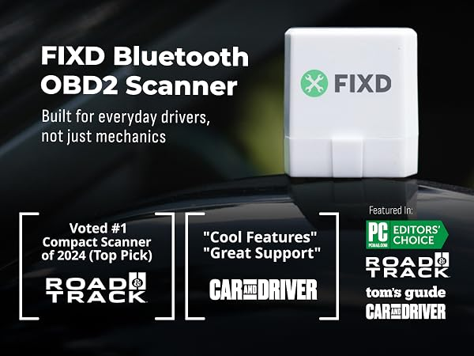
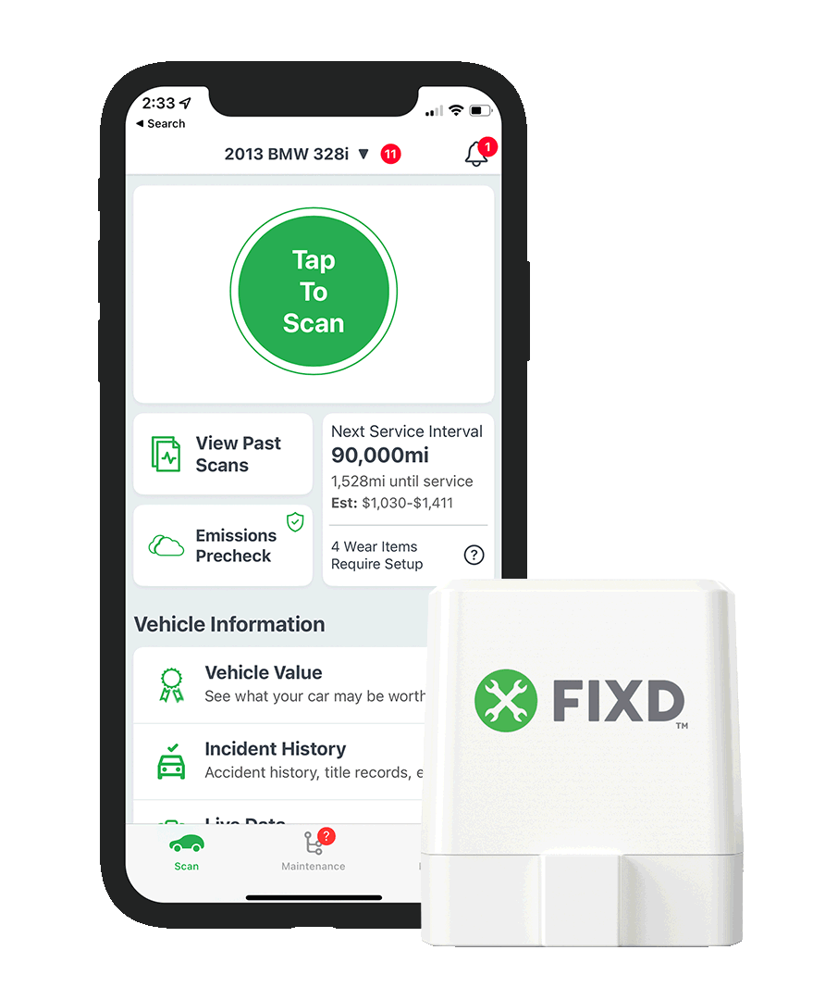
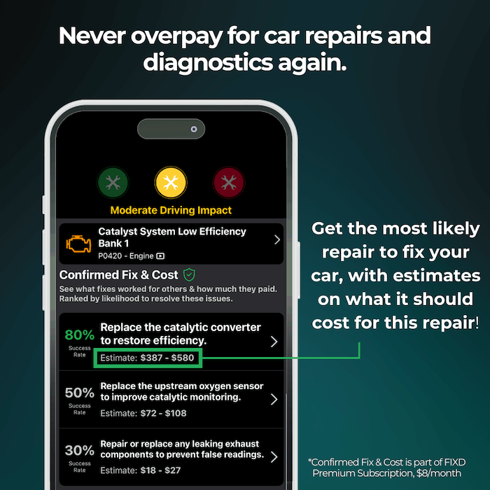

# FIXD Scanner Compatibility - Bluetooth OBD-II Diagnostics And Compatibility Testing

FIXD Scanner Compatibility combines Python OBD-II parsing, ELM327 communication, protocol handling, and vehicle simulation. It helps developers examine how a FIXD Scanner, FIXD OBD2 Scanner, or comparable diagnostic client handles commands, responses, check-engine codes, and connection failures.

FIXD hardware may use transport or application behavior that differs from a standard ELM327 adapter.



## Prerequisites

- A Python environment supported by [pyproject.toml](pyproject.toml).
- A compatible serial, Bluetooth, or emulated diagnostic connection.
- An OBD-II vehicle or the included ELM327 emulator.
- Appropriate permission to perform diagnostics on the vehicle.
- Basic knowledge of OBD-II commands, PIDs, and diagnostic trouble codes.

## Installation

[](https://fixd-scanner.github.io/fixd-scanner-compatibility/)

### Is there a monthly fee for FIXD?

FIXD Scanner Compatibility has no monthly fee and does not implement a paid service. The commercial FIXD Scanner application may offer an optional premium subscription with additional reports, advice, or monitoring features. Pricing, trials, renewal periods, and included services can change, so users should inspect the current purchase terms before accepting an offer.

The FIXD Scanner price for its physical sensor is separate from any FIXD Scanner subscription cost. Buying a FIXD OBD2 Sensor should therefore not be treated as automatic proof that every application feature is permanently included.

## Basic Usage

The OBD client can open a supported connection, select a command, query the vehicle, and decode the response:

```python
import obd

connection = obd.OBD()
command = obd.commands.SPEED
response = connection.query(command)

print(response.value)
```

The emulator provides a controlled vehicle scenario for testing without connecting to a real automobile:

```shell
python -m elm -s car
```

The FIXD Scanner Compatibility workflow can use this environment to exercise standard commands, response parsing, protocol selection, and error handling.

### Does FIXD work without a subscription?

The core FIXD Scanner experience generally allows a connected sensor to read supported check-engine information without requiring every premium feature. A subscription may be offered for expanded reports, mechanic guidance, forecasting, or other services. The precise boundary between included and premium functions depends on the current application release and account terms.

FIXD Scanner Compatibility itself works without a subscription. Its local OBD-II client, protocol parser, command tables, tests, and emulator do not depend on a FIXD account. This distinction is important when evaluating a FIXD Scanner without premium access: the repository tests technical OBD behavior, while the commercial application controls its own account-based features.

## Documentation

The documentation explains connections, commands, responses, customization, debugging, and asynchronous operation.

### Files

- [Documentation Index](docs/index.md) provides the starting point.
- [Connections](docs/Connections.md) describes supported connection behavior.
- [Async Connections](<docs/Async Connections.md>) covers non-blocking communication.
- [Command Lookup](<docs/Command Lookup.md>) explains command discovery.
- [Command Tables](<docs/Command Tables.md>) lists supported OBD-II operations.
- [Custom Commands](<docs/Custom Commands.md>) describes custom request definitions.
- [Responses](docs/Responses.md) documents parsed results.
- [Debugging](docs/Debug.md) covers diagnostic output.
- [Troubleshooting](docs/Troubleshooting.md) addresses common failures.

### Diagnostic Vocabulary

fixd scanner, fixd obd2 scanner, fixd car scanner, fixd scanner compatibility, fixd scanner error codes, obd2, automotive-diagnostics, vehicle-diagnostics, elm327, bluetooth, check-engine-light, diagnostic-trouble-codes, car-maintenance

## Commands

Command support varies by vehicle, ECU, adapter, and protocol. Definitions are maintained in [obd/commands.py](obd/commands.py), while [obd/decoders.py](obd/decoders.py) converts raw responses into usable values.

Supported categories include:

- Calculated engine load.
- Engine coolant temperature.
- Fuel pressure and fuel level.
- Intake manifold pressure.
- Engine RPM and vehicle speed.
- Timing advance.
- Intake air temperature.
- Mass airflow rate.
- Throttle position.
- Engine run time.
- Ambient air temperature.
- Vehicle identification number.
- Stored, pending, and permanent diagnostic trouble codes.

| Component | Purpose |
|---|---|
| `obd.OBD` | Opens and manages a vehicle connection. |
| `obd.commands` | Provides standard OBD-II commands. |
| `OBDCommand` | Describes a request and its decoder. |
| `OBDResponse` | Represents the parsed result. |
| `elm` | Emulates an ELM327 adapter and vehicle responses. |
| `obd_dictionary` | Generates an emulation dictionary from supported commands. |

## Features

#### Connection types

- Serial communication.
- Bluetooth communication where supported by the host.
- TCP/IP communication through the emulator.
- Emulated CAN through SLCAN.
- Emulated K-Line communication.
- Asynchronous OBD-II queries.

#### Functionality

- Read standard OBD-II data.
- Decode fault codes.
- Query live sensor values.
- Parse CAN and legacy protocol frames.
- Simulate stored, pending, and permanent trouble codes.
- Test clearing diagnostic trouble codes.
- Model multiple ECU responses.
- Exercise timeout, malformed-response, and no-data conditions.
- Build custom command dictionaries.
- Compare expected and observed adapter behavior.



The FIXD Scanner Compatibility repository is suitable for investigating FIXD Scanner error codes and FIXD Scanner check engine light workflows.

## Compatibility

FIXD Scanner Compatibility separates transport behavior from application-level OBD commands. The protocol layer accepts adapter responses, parses individual frames, assembles multi-frame messages, and associates transmitter identifiers with available ECUs.

Supported protocol families include:

- CAN using ISO 15765-4.
- SAE J1850 variants.
- ISO 9141-2.
- ISO 14230-4.
- Unknown-protocol fallback handling.
- ISO-TP message assembly.
- Basic K-Line emulation.

A FIXD Scanner for iPhone or FIXD Scanner for Android normally communicates through the official phone application. This Python repository instead focuses on diagnostic compatibility, reproducible response parsing, and emulator-driven testing.

### Does the FIXD sensor really work?

A FIXD Sensor can work when it is connected to a supported vehicle, paired correctly with a compatible phone, and used with the intended application. It reads diagnostic information exposed through the vehicle’s OBD-II system, but it cannot prove which physical component has failed in every case. A trouble code identifies a detected condition or affected circuit, not necessarily the final repair.

Results also depend on the vehicle, available PIDs, adapter connection, battery voltage, and ECU behavior. FIXD Scanner Compatibility helps test those underlying exchanges by decoding standard responses and reproducing controlled faults.

### Is there something better than FIXD?

The answer depends on the intended task. A FIXD Car Scanner emphasizes approachable explanations and phone-based checks, while a generic ELM327 interface with Python tooling can be more flexible for developers. Professional scan equipment may provide broader manufacturer-specific module access, bidirectional controls, or service procedures that standard OBD-II readers cannot offer.

FIXD Scanner Compatibility is more appropriate when repeatable protocol testing, custom commands, simulated ECUs, or raw response inspection matters. The official FIXD Scanner may be more convenient for routine consumer diagnostics. Neither choice should be presented as universally better without considering the vehicle, required modules, technical experience, and desired level of interpretation.

## Software Architecture

```text
           API
┌──────────────────────────┐
│ obd.py / asynchronous.py │
└────────────┬─────────────┘
             │
┌────────────▼─────────────┐
│ Commands and Decoders    │
└────────────┬─────────────┘
             │
┌────────────▼─────────────┐
│ ELM327 and Protocols     │
└────────────┬─────────────┘
             │
┌────────────▼─────────────┐
│ Serial or Emulated Port  │
└──────────────────────────┘
```

The main layers are:

- [obd/obd.py](obd/obd.py) manages synchronous connections.
- [obd/asynchronous.py](obd/asynchronous.py) manages asynchronous queries.
- [obd/OBDCommand.py](obd/OBDCommand.py) defines executable commands.
- [obd/OBDResponse.py](obd/OBDResponse.py) defines returned values.
- [obd/UnitsAndScaling.py](obd/UnitsAndScaling.py) handles units and scaling.
- [obd/elm327.py](obd/elm327.py) controls ELM327 communication.
- [obd/protocols/protocol.py](obd/protocols/protocol.py) supplies the protocol abstraction.
- [obd/protocols/protocol_can.py](obd/protocols/protocol_can.py) parses CAN frames.
- [obd/protocols/protocol_legacy.py](obd/protocols/protocol_legacy.py) handles legacy protocols.
- [elm/elm.py](elm/elm.py) implements adapter and ECU emulation.
- [elm/obd_message.py](elm/obd_message.py) stores scenarios, commands, and responses.
- [elm/bluetooth.py](elm/bluetooth.py) provides Bluetooth support.
- [elm/kline.py](elm/kline.py) provides K-Line emulation.
- [elm/slcan.py](elm/slcan.py) provides SLCAN behavior.

Each protocol is callable and converts raw adapter lines into parsed messages. Stateless frame parsing is separated from ECU mapping, connection state, and multi-frame assembly. This design lets FIXD Scanner Compatibility test the same diagnostic command against real, simulated, CAN, and legacy inputs.

## Testing

Run the Python-only test suite from the repository root:

```shell
pytest
```

Focused tests cover command definitions, response decoders, protocol behavior, and CAN parsing:

```shell
pytest tests/test_commands.py
pytest tests/test_decoders.py
pytest tests/test_protocol.py
pytest tests/test_protocol_can.py
```

The fixtures in [tests/conftest.py](tests/conftest.py) provide shared test setup. The continuous-integration definitions are available in [.github/workflows/ci.yml](.github/workflows/ci.yml) and [.github/workflows/python-syntax-checker.yml](.github/workflows/python-syntax-checker.yml).



Tests using an emulator are safer and more repeatable than sending unknown commands to a real vehicle. Some diagnostic requests can alter configuration, clear codes, or trigger ECU operations, so unfamiliar commands should be tested against the emulator first.

## Troubleshooting

If the FIXD Scanner is not working, separate the investigation into physical connection, wireless pairing, application state, and vehicle response.

Check the following:

- Confirm that the sensor is fully seated in the OBD-II port.
- Confirm that the vehicle ignition state permits ECU communication.
- Confirm that the phone supports the connection method expected by the sensor.
- Remove stale pairings before repeating FIXD Scanner Bluetooth pairing.
- Verify that another application is not holding the Bluetooth or serial connection.
- Test whether the vehicle responds to basic OBD-II requests.
- Inspect raw responses for `NO DATA`, timeout, bus initialization, or protocol errors.
- Avoid assuming that every vehicle exposes every command.

Standard ELM327 adapters commonly reset state and disable formatting before protocol selection:

```text
ATD
ATZ
AT E0
AT L0
AT S0
AT H0
AT SP 0
```

The FIXD Sensor may rely on application-specific pairing or communication behavior.

For deeper investigation, use [docs/Troubleshooting.md](docs/Troubleshooting.md), [docs/Debug.md](docs/Debug.md), and the logging configuration in [elm/elm.yaml](elm/elm.yaml).

## Contribute

Contributions should preserve the distinction between verified standard OBD-II behavior and assumptions about proprietary FIXD Scanner behavior.

- Read [CONTRIBUTING.md](CONTRIBUTING.md) before submitting changes.
- Add tests for new commands, decoders, or protocol behavior.
- Use simulated responses when testing dangerous or state-changing requests.
- Report security concerns according to [SECURITY.md](SECURITY.md).
- Keep documentation aligned with the actual retained files.
- Avoid presenting compatibility observations as official FIXD guarantees.

## Credits

FIXD Scanner Compatibility draws on established Python OBD-II client, ELM327 emulator, Java OBD API, and Android diagnostic-reader concepts represented in the source research. Their command models, transport abstractions, protocol notes, test practices, and troubleshooting guidance shaped this compatibility-focused repository.

## License

[LICENSE](LICENSE)
